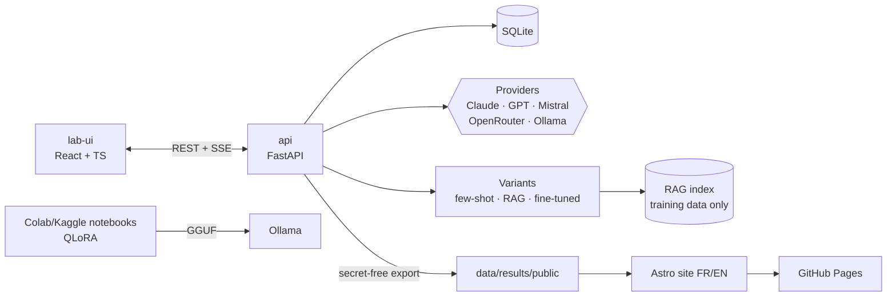

# Kabyle LLM Benchmark · taqbaylit

> 🇫🇷 [Version française](README.md)

**Measuring how well large language models handle Kabyle, then improving a small open-source model and proving the gain with numbers.**

> 🚧 **Status: under construction (phase 1, step 0).** No results are published yet. Every number in this repository will come from real model outputs and real human ratings.

## Why

Kabyle (taqbaylit) is a Berber language spoken by several million people, mainly in Kabylia (Algeria) and in the diaspora. It is still **low-resource** in digital terms. LLMs often confuse it with Arabic, French or other Berber languages, or produce invented words. This project measures that level in a rigorous, reproducible way.

## Principles

1. **Human references**: every Kabyle reference answer is written by a native speaker. No Kabyle text in the test set is AI-generated.
2. **No invented results**: every score can be traced back to the raw model output and its rating.
3. **Zero contamination**: test data is never used for training, few-shot examples or RAG. The separation is checked automatically in CI.
4. **Reproducibility**: each answer is stored with the model, date, parameters and test-set version (hash).

## The three phases

| Phase | Goal |
|---|---|
| 1. Measure | Build the lab, write the tests, query the models, grade blind |
| 2. Improve | Improve a small open-source model: few-shot → RAG → QLoRA fine-tuning |
| 3. Prove | Rerun the same benchmark, compare per category and analyse errors |

## Test categories

- Translation French → Kabyle
- Translation Kabyle → French
- Comprehension (short Kabyle text + question)
- Culture (proverbs, expressions, customs)
- Writing (Latin and Tifinagh scripts)
- Conversation (does the model really answer in Kabyle?)

## Architecture



The **lab** is a local application, never deployed, because it uses API keys. Only the **results site** is public.

## Quick start

Requirement: [Docker Desktop](https://www.docker.com/products/docker-desktop/).

```bash
cp .env.example .env          # then fill in API keys (optional for now)
docker compose up -d          # start the lab
```

- API and interactive docs: http://127.0.0.1:8800/docs
- Backend tests: `docker compose run --rm api pytest`

The lab only listens on localhost. Change the port with `LAB_PORT` in `.env`.
Test-set format: [docs/testset-format.md](docs/testset-format.md) (French).

## Licenses

- **Code**: [Apache-2.0](LICENSE)
- **Data** (test set, results): [CC BY 4.0](LICENSE-DATA.md)
- Third-party corpora used in phase 2 keep their own licenses (see `data/train/SOURCES.md`).

## Author

Designed and led by [@hasdaouiryma16-cmd](https://github.com/hasdaouiryma16-cmd), native Kabyle speaker.
