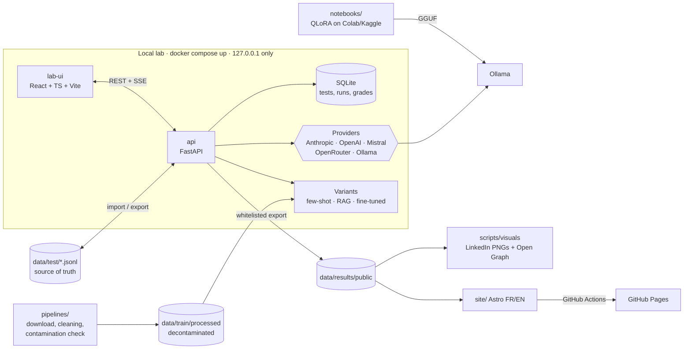

# Kabyle LLM Benchmark · taqbaylit

> 🇫🇷 [Version française](README.md) · 🌐 [Results site](https://hasdaouiryma16-cmd.github.io/kabyle-llm-benchmark/en/)

**Measuring how well large language models handle Kabyle, then improving a small open-source model and proving the gain with numbers.**

[](https://github.com/hasdaouiryma16-cmd/kabyle-llm-benchmark/actions/workflows/ci.yml)
[](https://hasdaouiryma16-cmd.github.io/kabyle-llm-benchmark/en/)
 

> **Status.** The lab, pipelines and site are ready. The test set is being written and **no results are published yet**. Every number in this repository will come from real model outputs and real human grades.

## Why

Kabyle (taqbaylit) is a Berber language spoken by several million people in Kabylia (Algeria) and in the diaspora. It is still **low-resource** in digital terms. LLMs often confuse it with Arabic, French or other Berber languages, or invent words. This project measures that level in a rigorous, reproducible and open way.

## Non-negotiable principles

1. **Human references.** Every Kabyle reference answer is written by a native speaker. No Kabyle text in the test set is AI-generated.
2. **No invented results.** Every score can be traced back to the raw model output and its grade. Without real data, the site shows "results coming soon".
3. **Zero contamination.** Test data is never used for training, few-shot examples or RAG. The separation is checked automatically at three levels: pipeline, lab and CI.
4. **Reproducibility.** Each answer is stored with the model, date, exact parameters and the SHA-256 hash of the test set.

## The three phases

| Phase | Goal | Where |
|---|---|---|
| 1. Measure | Write tests, query models, grade blind | Lab (`backend/`, `lab-ui/`) |
| 2. Improve | Small open-source model: few-shot → RAG → QLoRA fine-tuning | `pipelines/`, `notebooks/`, [`docs/phase2.md`](docs/phase2.md) (French) |
| 3. Prove | Same benchmark on the base model and each variant, paired gains, error analysis | Lab → public site |

## Test categories

| Category | What is measured | Grading |
|---|---|---|
| Translation French → Kabyle | Producing Kabyle | chrF++ + human |
| Translation Kabyle → French | Understanding written Kabyle | chrF++ + human |
| Comprehension | Short Kabyle text + question | human (+ chrF++) |
| Culture | Proverbs, expressions, customs | human |
| Writing | Kabyle Latin script and Tifinagh | chrF++ + human |
| Conversation | Does the model really answer in Kabyle? | human + language detection |

## Architecture



The **lab** is a local application, never deployed, because it uses API keys. Only the static **results site** is public. Technical choices and their rationale are logged in [`docs/decisions.md`](docs/decisions.md) (French).

## Quick start

Requirement: [Docker Desktop](https://www.docker.com/products/docker-desktop/). Ollama is optional, for local models.

```bash
git clone https://github.com/hasdaouiryma16-cmd/kabyle-llm-benchmark.git
cd kabyle-llm-benchmark
cp .env.example .env      # add the API keys you need (never committed)
docker compose up -d      # API + UI
```

- Lab UI: <http://127.0.0.1:5173>
- API and interactive docs: <http://127.0.0.1:8800/docs>

## Reproducing the results

1. Run `docker compose up -d`, then in the **Tests** tab click **Recharger** (reload) to load the public test set from `data/test/`.
2. Add API keys to `.env`, then start a run on the same models. `backend/config/models.yaml` holds the exact model IDs and parameters.
3. Grade blind and compare: the test-set hash guarantees you evaluate the same thing.

The private part of the test set (≈ 20%) is not published. Scores that include it can only be reproduced by the author; the site distinguishes both.

## Adding a model

Add an entry to `backend/config/models.yaml`. For a new provider, write a class in `backend/app/providers.py`. See [`docs/add-a-model.md`](docs/add-a-model.md) (French).

## Limitations

- **A single annotator.** The grades reflect one variety of Kabyle and particular spelling choices.
- **A modest test set.** Confidence intervals are wide.
- **Conservative language detection.** Without GlotLID, it only catches obvious failures.
- **chrF++ only measures surface similarity.** The human grade is authoritative.
- **Current Claude models no longer accept a temperature setting.** This is documented, and the actual parameters are stored with every answer.
- **Dated results.** They hold for the model versions and date shown.

## Licenses

- **Code**: [Apache-2.0](LICENSE)
- **Data** (public test set, results): [CC BY 4.0](LICENSE-DATA.md)
- **Third-party corpora** (phase 2): original licenses, see [`data/train/SOURCES.md`](data/train/SOURCES.md)

## Author

Designed and led by [@hasdaouiryma16-cmd](https://github.com/hasdaouiryma16-cmd): native Kabyle speaker, full-stack / DevOps / AI developer.
