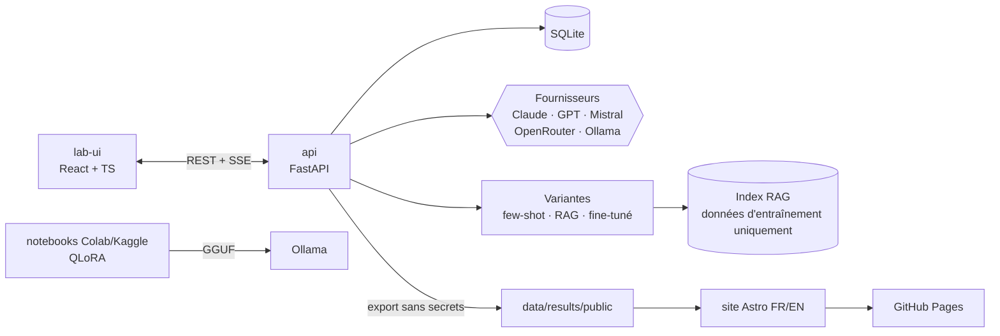

# Kabyle LLM Benchmark · taqbaylit

> 🇬🇧 [English version](README.en.md)

**Mesurer à quel point les grands modèles de langage maîtrisent le kabyle, puis améliorer un petit modèle open source et prouver le gain avec des chiffres.**

> 🚧 **Statut : en construction (phase 1, étape 0).** Aucun résultat n'est encore publié. Tous les chiffres de ce dépôt proviendront de vraies réponses de modèles et de notations humaines réelles.

## Pourquoi

Le kabyle (taqbaylit) est une langue berbère parlée par plusieurs millions de personnes, principalement en Kabylie (Algérie) et dans la diaspora. Il reste **peu doté** en ressources numériques. Les LLM le confondent souvent avec l'arabe, le français ou d'autres langues berbères, ou produisent des mots inventés. Ce projet mesure ce niveau de façon rigoureuse et reproductible.

## Principes

1. **Références humaines** : toutes les réponses de référence en kabyle sont écrites par une locutrice native. Aucun texte kabyle n'est généré par IA dans le jeu de test.
2. **Aucun résultat inventé** : chaque score est traçable jusqu'à la réponse brute du modèle et à sa notation.
3. **Zéro contamination** : les données de test ne servent jamais à l'entraînement, au few-shot ni au RAG. La séparation est vérifiée automatiquement en CI.
4. **Reproductibilité** : chaque réponse est enregistrée avec le modèle, la date, les paramètres et la version (hash) du jeu de tests.

## Les trois phases

| Phase | Objectif |
|---|---|
| 1. Mesurer | Construire le labo, écrire les tests, interroger les modèles, noter à l'aveugle |
| 2. Améliorer | Améliorer un petit modèle open source : few-shot → RAG → fine-tuning QLoRA |
| 3. Prouver | Repasser le même benchmark, comparer par catégorie et analyser les erreurs |

## Catégories de tests

- Traduction français → kabyle
- Traduction kabyle → français
- Compréhension (court texte kabyle + question)
- Culture (proverbes, expressions, coutumes)
- Écriture (alphabet latin et tifinagh)
- Conversation (le modèle répond-il vraiment en kabyle ?)

## Architecture



Le **labo** est une application locale, jamais déployée, car elle utilise des clés API. Seul le **site de résultats** est public.

## Arborescence

```
backend/     API FastAPI, fournisseurs, runner, notation
lab-ui/      interface du labo (React + TypeScript + Vite)
data/test/   🔒 jeu de test (jamais utilisé pour l'entraînement)
data/train/  🧪 données d'amélioration (sources ouvertes, licences documentées)
pipelines/   préparation, nettoyage, dédoublonnage, contrôle de contamination
notebooks/   fine-tuning QLoRA (Colab / Kaggle)
site/        site public de résultats (GitHub Pages)
docs/        méthodologie, métriques, décisions techniques
```

## Démarrage rapide

Prérequis : [Docker Desktop](https://www.docker.com/products/docker-desktop/).

```bash
cp .env.example .env          # puis renseigner les clés API (facultatif à ce stade)
docker compose up -d          # lance le labo
```

- API et documentation interactive : http://127.0.0.1:8800/docs
- Tests du backend : `docker compose run --rm api pytest`

Le labo n'écoute que sur la machine locale. Le port se change avec `LAB_PORT` dans `.env`.
Format du jeu de tests : [docs/testset-format.md](docs/testset-format.md).

## Licences

- **Code** : [Apache-2.0](LICENSE)
- **Données** (jeu de test, résultats) : [CC BY 4.0](LICENSE-DATA.md)
- Les corpus tiers utilisés en phase 2 gardent leur propre licence (voir `data/train/SOURCES.md`).

## Autrice

Projet conçu et mené par [@hasdaouiryma16-cmd](https://github.com/hasdaouiryma16-cmd), locutrice native du kabyle.
