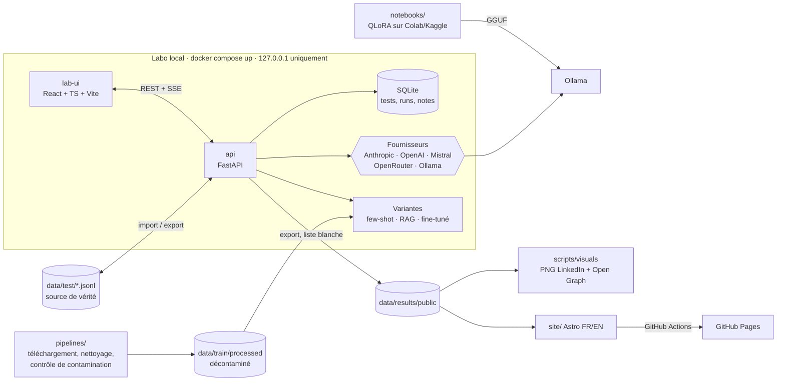

# Kabyle LLM Benchmark · taqbaylit

> 🇬🇧 [English version](README.en.md) · 🌐 [Site des résultats](https://hasdaouiryma16-cmd.github.io/kabyle-llm-benchmark/)

**Mesurer à quel point les grands modèles de langage maîtrisent le kabyle, puis améliorer un petit modèle open source et prouver le gain avec des chiffres.**

[](https://github.com/hasdaouiryma16-cmd/kabyle-llm-benchmark/actions/workflows/ci.yml)
[](https://hasdaouiryma16-cmd.github.io/kabyle-llm-benchmark/)
 

> **Statut.** Le labo, les pipelines et le site sont prêts. Le jeu de test est en cours d'écriture et **aucun résultat n'est encore publié**. Chaque chiffre de ce dépôt viendra de vraies réponses de modèles et de notations humaines réelles.

## Pourquoi

Le kabyle (taqbaylit) est une langue berbère parlée par plusieurs millions de personnes en Kabylie (Algérie) et dans la diaspora. Il reste **peu doté** en ressources numériques. Les LLM le confondent souvent avec l'arabe, le français ou d'autres langues berbères, ou produisent des mots inventés. Ce projet mesure ce niveau de façon rigoureuse, reproductible et ouverte.

## Principes non négociables

1. **Références humaines.** Toutes les réponses de référence en kabyle sont écrites par une locutrice native. Aucun texte kabyle du jeu de test n'est généré par une IA.
2. **Aucun résultat inventé.** Chaque score est traçable jusqu'à la réponse brute du modèle et à sa notation. Sans données réelles, le site affiche « résultats à venir ».
3. **Zéro contamination.** Les données de test ne servent jamais à l'entraînement, au few-shot ni au RAG. La séparation est vérifiée automatiquement à trois niveaux : pipeline, labo et CI.
4. **Reproductibilité.** Chaque réponse est enregistrée avec le modèle, la date, les paramètres exacts et l'empreinte SHA-256 du jeu de test.

## Les trois phases

| Phase | Objectif | Où |
|---|---|---|
| 1. Mesurer | Écrire les tests, interroger les modèles, noter à l'aveugle | Labo (`backend/`, `lab-ui/`) |
| 2. Améliorer | Petit modèle open source : few-shot → RAG → fine-tuning QLoRA | `pipelines/`, `notebooks/`, [`docs/phase2.md`](docs/phase2.md) |
| 3. Prouver | Même benchmark sur la base et chaque variante, gains appariés, analyse des erreurs | Labo → site public |

## Catégories de tests

| Catégorie | Ce qui est mesuré | Notation |
|---|---|---|
| Traduction français → kabyle | Production en kabyle | chrF++ + humaine |
| Traduction kabyle → français | Compréhension du kabyle écrit | chrF++ + humaine |
| Compréhension | Court texte kabyle + question | humaine (+ chrF++) |
| Culture | Proverbes, expressions, coutumes (Yennayer, tiwizi…) | humaine |
| Écriture | Alphabet latin kabyle et tifinagh | chrF++ + humaine |
| Conversation | Le modèle répond-il vraiment en kabyle ? | humaine + détection de langue |

## Architecture



Le **labo** est une application locale, jamais déployée, car elle utilise des clés API. Seul le **site de résultats**, statique, est public. Les choix techniques et leurs justifications sont dans [`docs/decisions.md`](docs/decisions.md).

## Démarrage rapide

Prérequis : [Docker Desktop](https://www.docker.com/products/docker-desktop/). Ollama est optionnel, pour les modèles locaux.

```bash
git clone https://github.com/hasdaouiryma16-cmd/kabyle-llm-benchmark.git
cd kabyle-llm-benchmark
cp .env.example .env      # renseigner les clés API voulues (jamais commité)
docker compose up -d      # API + interface
```

- Interface du labo : <http://127.0.0.1:5173>
- API et documentation interactive : <http://127.0.0.1:8800/docs>

Guide complet (saisie, exécution, notation, export, sauvegardes) : [`docs/lab.md`](docs/lab.md).

## Reproduire les résultats

1. `docker compose up -d`, puis, dans l'onglet **Tests**, cliquer sur **Recharger** pour charger le jeu de test public depuis `data/test/`.
2. Renseigner les clés API dans `.env`, puis lancer une exécution sur les mêmes modèles. `backend/config/models.yaml` contient les identifiants et paramètres exacts.
3. Noter à l'aveugle (onglet **Notation**) et comparer : l'empreinte du jeu de test garantit que l'on évalue la même chose.

La partie privée du jeu de test (≈ 20 %) n'est pas publiée. Les scores qui l'incluent ne sont donc reproductibles que par l'autrice, et le site distingue les deux.

## Documentation

| Document | Contenu |
|---|---|
| [`docs/methodology.md`](docs/methodology.md) | Protocole, catégories, notation, analyse des erreurs |
| [`docs/metrics.md`](docs/metrics.md) | chrF++, BLEU, détection de langue, intervalles de confiance, gains appariés |
| [`docs/lab.md`](docs/lab.md) | Utiliser le labo au quotidien |
| [`docs/add-a-model.md`](docs/add-a-model.md) | Ajouter un modèle ou un fournisseur |
| [`docs/phase2.md`](docs/phase2.md) | Choix du petit modèle, données, few-shot, RAG, QLoRA, coûts |
| [`docs/communication.md`](docs/communication.md) | Brouillons LinkedIn et portfolio (à compléter avec les vrais résultats) |
| [`docs/testset-format.md`](docs/testset-format.md) | Format du jeu de tests |
| [`data/test/DATASET_CARD.md`](data/test/DATASET_CARD.md) | Fiche du jeu de données |
| [`data/train/SOURCES.md`](data/train/SOURCES.md) | Sources d'amélioration et licences vérifiées |
| [`docs/decisions.md`](docs/decisions.md) | Journal des décisions techniques |

## Limites

- **Une seule annotatrice.** Les notes reflètent une variété de kabyle et des choix orthographiques particuliers. Plusieurs références par test atténuent ce biais.
- **Un jeu de test de taille modeste.** Les intervalles de confiance sont larges et les petits écarts ne sont pas significatifs.
- **Une détection automatique de la langue prudente.** Sans GlotLID, elle ne repère que les échecs évidents.
- **chrF++ ne mesure qu'une proximité de surface.** La note humaine fait foi.
- **Les modèles Claude actuels n'acceptent plus de réglage de température.** C'est documenté : leurs paramètres réels sont enregistrés avec chaque réponse.
- **Des résultats datés.** Ils valent pour les versions de modèles et la date indiquées.

## Licences

- **Code** : [Apache-2.0](LICENSE)
- **Données** (jeu de test public, résultats) : [CC BY 4.0](LICENSE-DATA.md)
- **Corpus tiers** (phase 2) : licences d'origine, voir [`data/train/SOURCES.md`](data/train/SOURCES.md)

## Autrice

Projet conçu et mené par [@hasdaouiryma16-cmd](https://github.com/hasdaouiryma16-cmd), locutrice native du kabyle, développeuse full-stack, DevOps et IA.
